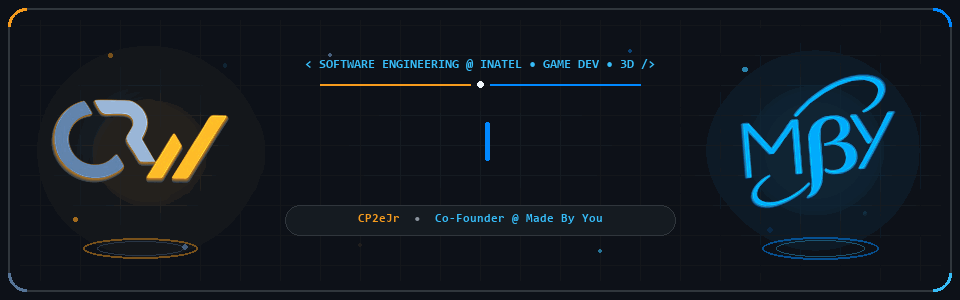
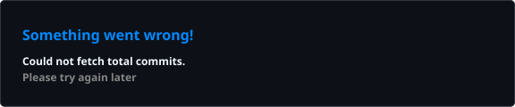
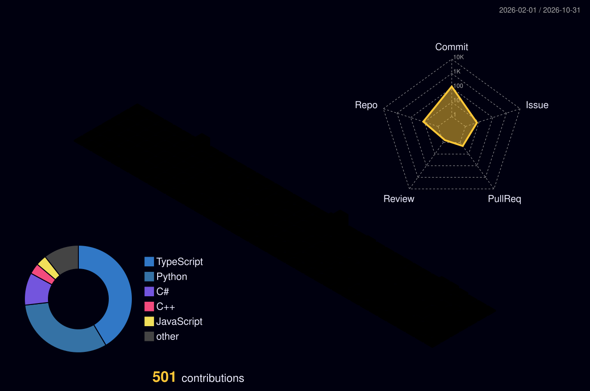

  

    

  

    
    &nbsp;
    
    &nbsp;
    
    &nbsp;
    
  

 

<table>
  <tr>
    <td width="50%" valign="top">
      <h4 align="center">Português</h4>
      

        Olá! Eu sou o <b>Vitor Hugo Felipe Noronha</b> (<b><code>XKrules</code></b>), Desenvolvedor Front-End e graduando em <b>Engenharia de Software</b> no <a href="https://inatel.br/" target="_blank"><b>Inatel</b></a>.
      

      <ul>
        <li>Construo interfaces modernas e responsivas que chegam ao usuário final, resolvendo o caminho completo do requisito à entrega com <b>React.js</b>, <b>Next.js</b> e <b>TypeScript</b>, apoiado por uma base sólida em <b>C++</b>, <b>C</b>, <b>Java</b> e <b>Python</b>.</li>
        <li>Atuo como <b>Coordenador de Pesquisa e Desenvolvimento (P&amp;D)</b> e Gerente de Projetos na <a href="https://cp2ejr.com.br/" target="_blank"><b>CP2eJr</b></a>, onde lidero o ciclo de P&amp;D e conduzi o desenvolvimento da plataforma web/app <i>CP2eJR - Corporative</i>.</li>
        <li>Sou <b>Co-Fundador da <a href="https://www.instagram.com/use.mby/" target="_blank">Made By You</a></b>, transformando conceitos criativos em produtos digitais reais.</li>
        <li>Pesquisador de Iniciação Científica no <a href="https://inatel.br/" target="_blank"><b>Inatel</b></a> em Modelagem Computacional e Manufatura Aditiva 3D, Técnico em Eletrônica pela ETE FMC e desenvolvedor de jogos em <b>GML (GameMaker)</b> e <b>Construct 3</b> (premiado com <i>Melhor Visual</i> na Game Jam Cubio).</li>
      </ul>
    </td>
    <td width="50%" valign="top">
      <h4 align="center">English</h4>
      

        Hi! I'm <b>Vitor Hugo Felipe Noronha</b> (<b><code>XKrules</code></b>), a Front-End Developer and <b>Software Engineering</b> undergraduate at <a href="https://inatel.br/" target="_blank"><b>Inatel</b></a>.
      

      <ul>
        <li>I build modern, responsive interfaces that reach the end user — owning the full path from requirement to delivery with <b>React.js</b>, <b>Next.js</b>, and <b>TypeScript</b>, backed by a strong algorithmic foundation in <b>C++</b>, <b>C</b>, <b>Java</b>, and <b>Python</b>.</li>
        <li>I serve as <b>Research &amp; Development (R&amp;D) Coordinator</b> and Project Manager at <a href="https://cp2ejr.com.br/" target="_blank"><b>CP2eJr</b></a>, leading the R&amp;D cycle and spearheading the development of the <i>CP2eJR - Corporative</i> web/app platform.</li>
        <li><b>Co-Founder at <a href="https://www.instagram.com/use.mby/" target="_blank">Made By You</a></b>, turning creative concepts into real-world digital products.</li>
        <li>Undergraduate Researcher at <a href="https://inatel.br/" target="_blank"><b>Inatel</b></a> in Computational Modeling and 3D Additive Manufacturing, certified Electronics Technician (ETE FMC), and game developer in <b>GML (GameMaker)</b> and <b>Construct 3</b> (winner of the <i>Best Visuals</i> award at the Cubio Game Jam).</li>
      </ul>
    </td>
  </tr>
</table>

 

  

 

  
  

  

 

  

 

<h3 align="center">Vamos nos conectar! / Let's Connect!</h3>

  
  &nbsp;
  
  &nbsp;
  

 

  

